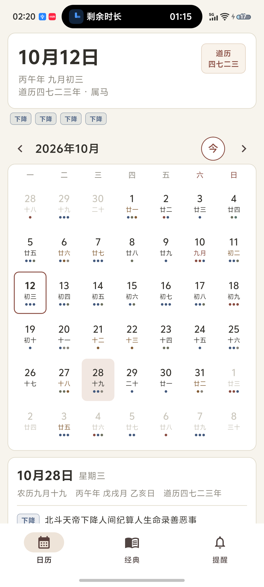
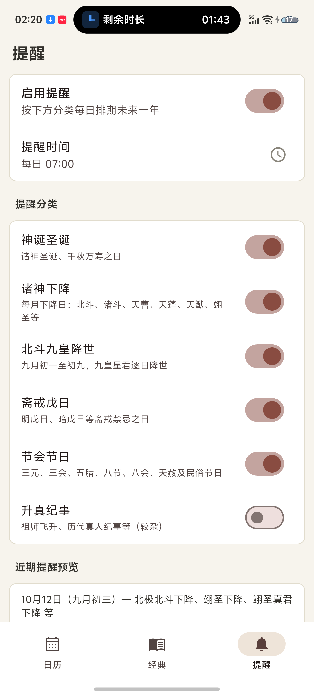

# 道历 · DaoistCalendar

道教历法与神诞下降提醒 App。Flutter 单代码库，Android / iOS 双端；数据完全离线，一次安装永久可用。

| 日历 | 经典 | 提醒 |
|:---:|:---:|:---:|
|  |  |  |

## 功能特性

- **道历月历**：公历×农历对照，干支纪年月日、道历纪年（四七二三）、节气、生肖、戊日标注，事件按分类以色点呈现；任意翻页后一键回到今天。
- **当日详情**：农历、干支（年/月/日）、道历纪年、节气，以及当日神诞、下降、节会、斋戒事件列表。
- **北斗九皇降世**：九月初一至初九逐日标注星君（初一贪狼 → 初九右弼），九皇会独立提醒分组。
- **每月诸神下降**：初三/廿七北极北斗下降、初七西斗、初八南斗、初九东斗北阴、初十长生保命、十一消灾解厄、廿五天蓬北斗出游、廿九北阴等，逐月自动排期。
- **经典与神尊**：玉皇经、北斗经（附本命星君表）、度人经、灵宝经、玉枢经（雷经）、救苦经、灵官经、三官经、南斗经、清静经等十四部，各系神尊圣诞、下降、斋期与下次日期。
- **斋戒戊日**：明戊日（六戊日）与暗戊日（每月固定地支）自动判定。
- **节会**：三元日、三会日、五腊日、八节日（含八位天尊下降）、八会日（干支锚点）、天赦日。
- **分类提醒**：神诞 / 诸神下降 / 九皇降世 / 斋戒戊日 / 节会节日 / 升真纪事六类独立开关，提醒时间可调，本地通知预排未来 400 天，重启不丢。

## 安装

从 [Releases](../../releases) 下载最新 `道历_vX.X.X.apk`，手机直接安装。

- Android 8.0+；首次启动请允许通知权限，提醒即自动排期。
- iOS 版需自行用 Xcode 构建安装（本仓库不含签名包）。

## 构建与测试

```bash
# 环境：Flutter stable（3.47+）、Android SDK、JDK 17
cd app
flutter pub get
flutter test                 # 规则引擎单元测试
flutter build apk --release  # 产物 build/app/outputs/flutter-apk/app-release.apk
```

iOS：`cd app && flutter build ios`（需 macOS + Xcode）。

## 数据与规则引擎

事件不是逐日快照，而是**规则计算**——五类规则覆盖全部事件，可外推至任意年份：

| 规则类型 | 例子 |
|---|---|
| 农历月日 | 正月初九玉皇圣诞、二月十五老君圣诞 |
| 每月第 N 日 | 初三/廿七北极北斗下降、廿五天蓬下降·北斗出游 |
| 节气锚定 | 冬至元始天尊圣诞、夏至灵宝天尊圣诞、四立二分二至八节日 |
| 日干支 | 明戊日（天干逢戊）、天赦日（春戊寅·夏甲午·秋戊申·冬甲子） |
| 农历月×地支 | 暗戊日（正月未、二月戌、三月辰…）；八会日（天会丙午、地会壬午…） |

规则库打包在 `app/assets/data/rules.json`（事件目录 360+ 条、年度规则 600+ 条），典籍补全条目（九皇逐日星君、雷斋、玉帝巡天等）均在数据内标注。数据管线位于 `tools/`：

```bash
python tools/scrape_daoli.py    # 抓取逐年月页 → data/raw/months/
python tools/analyze_rules.py   # 事件模式归纳 → data/analysis_report.json
python tools/build_rules.py     # 生成规则库 + 对账 → app/assets/data/rules.json
```

修改规则 / 增补条目：编辑 `tools/build_rules.py` 中的规则表 → 重跑脚本 → 重新构建 App 即可。

## 目录结构

```
app/                  Flutter 应用（lib/ 引擎、界面、通知；assets/data/ 离线规则库）
tools/                数据管线（抓取、规则归纳、规则库生成、图标生成）
data/                 抓取缓存、分析报告、对账报告
docs/screenshots/     应用截图
```

## 口径说明

各道派、宫观仪范或有差异（如三会日「十月五日/十月十五」两说、暗戊表诸家不同），本 App 采用通行道历口径；请以所属传承为准。
